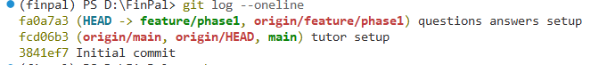
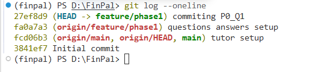
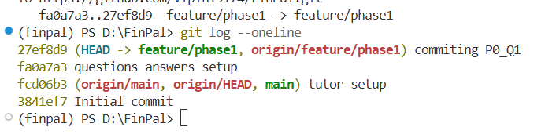

# Phase 0: Foundations (weeks 1–3)

This is the single workbook for Phase 0. Each session has its questions, then rounds of answers and reviews in order:

1. **Questions**: written by the tutor.
2. **Answers, attempt N**: written by you, in your own words. Add a new attempt below the last review; do not edit old attempts.
3. **Review N**: written by the tutor after you ask for a review.

A session is closed when its review says so.

---

## Week 1, session 1: terminal, environments, Git

**Status: closed.** Final mark 7/7 after two attempts. One follow-up is open (see Review 2).

### Questions

Check questions:

1. What does "working directory" mean?
2. Why do we not commit the virtual environment folder to Git?
3. What is the difference between `git commit` and `git push`?
4. In `git log --oneline`, what do `HEAD`, `main` and `origin/main` each point to?
5. If you make two commits without pushing, which line of `git log --oneline` will `origin/main` appear on?
6. You added `Solutions/` to `.gitignore`. Why did `git status` then show `.gitignore` as modified but not show `Solutions/`?
7. What does `-u` do in `git push -u origin <branch-name>`, and why is it only needed the first time?

Hands-on tasks:

- [x] Run `test.py` from the terminal and explain what happens for an empty file.
- [x] Say how the `finpal` environment was created, and show how to tell from the prompt that it is active.
- [x] Commit the pending `.gitignore` change on `feature/phase1` and push it.
- [x] Run `git log --oneline` before and after the push and note where `origin/feature/phase1` sits each time.

### Answers, attempt 1

Check questions:

1. Means the directory in which we are currently in. Everything we do is relative to the current working directory.
2. We do not commit the virtual environment folders becuase it is the run time code that is used as environment at our local machine. There is no requirement of pushing them. When such a environment is required by anyone who want replicate or add on the project can clone and install the mentioned liberaries, packages (spin up the matching environment).
3. Git commit locks the changes into the local while push sends it to the remote repo.
4. HEAD: current pointer where it is pointing to.
   'main' means local main.
   'origin/main': remote repo main
5. 3rd line
6. because it has been added into .gitignore so the git ignores it and do not track it.
7. 'u' untracked. It links the local feature branch with the remote repo and create the same branch on remote repo.

Hands-on tasks:

1. It runs and returns no output.
2. It is created using the conda environment. And it is activated via a conda's command. And the prompt in therminal comes with the environment name which is (finalpal) in this case
3. and 4. Befor push

   

   after push

   

### Review 1

Check questions: **5.5 / 7**.

| # | Mark | Feedback |
| --- | --- | --- |
| 1 | Correct | Clear, and includes the "everything is relative to it" part. |
| 2 | Correct | Right idea: others rebuild it instead of downloading yours. That only works if the list of packages is committed (for conda, an `environment.yml`). There is none yet. |
| 3 | Correct | Exactly right. |
| 4 | Half | `main` is right. `HEAD` is the commit you currently have checked out, the "you are here" marker. `origin/main` is not GitHub's `main` live; it is your laptop's memory of it from the last push, pull or fetch. |
| 5 | Correct | Third line: the two new commits take lines 1 and 2. |
| 6 | Half | Explains why `Solutions/` is hidden, but not why `.gitignore` showed as modified. |
| 7 | Half | The linking part is right. `-u` is short for `--set-upstream`, not "untracked". The push itself creates the branch on GitHub, not `-u`. "Why only the first time?" was not answered. |

Hands-on tasks:

1. Correct. No statements means nothing to do, so Python exits quietly without an error.
2. Correct. The prompt shows `(finpal)`, not `(finalpal)`. Still to answer: the exact command that created it.
3. Commit done (`27ef8d9`), push not done: the branch was "ahead 1" of `origin/feature/phase1`.
4. Screenshots mislabelled. The first is before the *commit* (both labels on one line). The second is after the commit but before the push (`HEAD` moved up, `origin/feature/phase1` stayed behind). The second one is the gap question 5 asks about.

To do: push, check where `origin/feature/phase1` sits, and redo answers 4, 6 and 7.

### Answers, attempt 2

1. push done
2. first line

   

3. Redone answers:
   - (ans 4) head : last commit. origin/main: commit where remote repo's main was when you took the pull.
   - (ans 6) git ignored was shown as modified because it was altered.
   - (ans 7) -u: set upstream. Only first time becuase once the branch has been set on upstream, after that only sync is reuired done by git push

### Review 2

Check questions: **7 / 7**.

| # | Mark | Feedback |
| --- | --- | --- |
| 4 | Correct | `origin/main` is right; it also updates on push and fetch, not only pull. `HEAD` as "last commit" is accepted, with one refinement: it is the commit you have checked out. That is the last commit on your current branch almost always, but if you check out an older commit, `HEAD` goes there. |
| 6 | Correct | `.gitignore` is a tracked file like any other, so editing it shows as modified. |
| 7 | Correct | The link is remembered, so plain `git push` knows where to go. |

Hands-on tasks:

- Push confirmed: local `feature/phase1` and `origin/feature/phase1` are on the same commit, so the label is on the first line as you said.

Open follow-up, to answer at the start of session 2:

- What exact command created the `finpal` environment?

### Answers, attempt 3

Follow-up: conda create -n finpal python=3.12 -y

### Review 3

Correct, and it matches the environment on disk (Python 3.12). Reading the command piece by piece:

- `conda create` makes a new environment.
- `-n finpal` names it. That name is what appears in the prompt as `(finpal)`.
- `python=3.12` pins the Python version inside it, separate from the global 3.13.
- `-y` answers "yes" to the confirmation prompt in advance.

Session 1 is fully closed, with nothing open.
